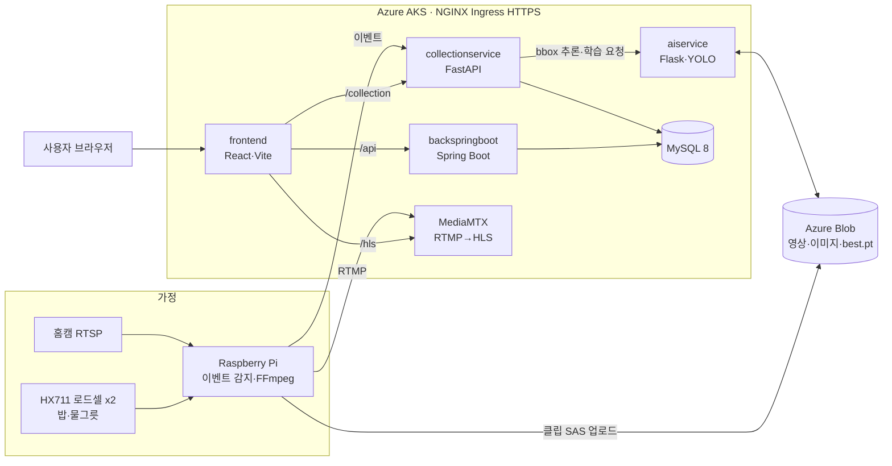

# 캣밥바라기 (wantedcat)

> 밥·물그릇 무게 변화 + 홈캠 영상으로 고양이별 식사·음수 기록을 자동화하는 IoT·AI 서비스

> KT AIVLE School 7기 AI 트랙 빅프로젝트(수도권 5반 14조) 팀 레포 [`KT-AIVLE-BIGPJ-05-14/wantedcat`](https://github.com/KT-AIVLE-BIGPJ-05-14/wantedcat)의 포크
> 이 포크는 초기 구조 세팅 시점(2025-07-28, 커밋 3개)만 포함 → 최종 코드는 원본 레포 기준으로 정리

<!-- TODO: 대표 이미지 docs/images/hero.jpg (1P 설명서 또는 대시보드 캡처, 사용자 확인 후) -->

| 기간 | 인원 | 역할 | 상태 |
|---|---|---|---|
| 2025.07 ~ 2025.08 (빅프로젝트 07.09 ~ 08.28 최종산출물 제출, 2025.09 ZEP 온라인 발표회) | 6명 (최종 발표 기준) | UI/UX 디자인 · 기획 | 완료 |

<!-- TODO: 인원 — 주차별 워크시트(1~7주차)는 7명, 최종 발표자료·과제 정의서는 6명. GitHub org 멤버는 7명. 사용자 확인 -->

**Tech** `Raspberry Pi` `Python` `YOLO11 (Ultralytics)` `FastAPI` `Flask` `Spring Boot 3.4 / Java 21` `React 19 / TypeScript` `Azure AKS·Blob Storage`

## 내 역할 (이창희)
> 팀 레포에 본인 명의 커밋·PR이 없어, 팀 산출물 문서와 개인 작업 파일 기준으로만 기재

- **최종 담당**: UI/UX 디자인
- **기획 단계(1주차)**: 개인 과제안 제출, 조원 6명 아이디어에 질문·보완점·9개 기준 평가를 담은 아이디어 리뷰 작성, 의사결정 매트릭스 양식에 후보안 4개 정리
- **발표 준비**: 최종 발표 PPT·서비스 개념도 슬라이드 수정 (2025-08-21 ~ 08-26)
- 코드 구현(백엔드·프론트·디바이스·AI 서버)은 다른 팀원 커밋 → 아래 "주요 기능"·"아키텍처"는 팀 결과물 설명

<!-- TODO: UI/UX 디자인의 실제 범위(웹 화면 설계/발표자료 디자인), 시연·1분 숏영상 편집 참여 여부 — 사용자 확인 후 추가 -->

## 1. 개요
- **문제**: 다묘 가정에서 어느 고양이가 언제 얼마나 먹고 마셨는지 사람이 직접 확인해야 함
- **목표**: 그릇 무게 센서 + 홈캠 + 고양이 개체 인식 모델로 식사·음수 이벤트를 자동 기록·조회
- **결과**: 센서 이벤트 → 영상 클립 → YOLO 2단계 추론(고양이 검출 → 개체 분류) → 웹 대시보드까지 AKS에 HTTPS 배포 (원본 커밋 `250827 : ingress 및 https 배포 완료`)

## 2. 주요 기능
- 식사·음수 이벤트 감지 — HX711 로드셀 2개로 밥·물그릇 무게 변화 감지, 2초 안정 시 종료·최대 60초 강제 종료
- 이벤트 영상 클립 — 홈캠 RTSP를 FFmpeg로 HLS 세그먼트(2초) 저장, 이벤트 2초 전부터 잘라 Azure Blob 업로드
- 고양이 개체 인식 — YOLO0(고양이 bbox 검출) + 사용자별 YOLO2(yolo11s, 내 고양이 분류) 2단계 추론, bbox 영상 생성
- 사용자별 모델 학습 — 고양이 사진 업로드 → 데이터셋 구성 → YOLO2 학습 → best.pt를 Blob에 저장
- 실시간 홈캠 — Raspberry Pi → RTMP → MediaMTX → HLS(`hls.js`) 웹 재생
- 기기 등록 — BLE GATT 서버(`bleno`)로 Wi-Fi·홈캠 IP를 전달받아 Pi 네트워크 자동 설정
- 웹 서비스 — 고양이·기기 관리, 식사 통계·일정, 게시판·Q&A·공지, 마이페이지·관리자 페이지

<!-- TODO: 데모 GIF/사진 2~4장 docs/images/ (대시보드, bbox 영상, 기기 사진) -->

## 3. 아키텍처

- 센서 이벤트 → Pi가 클립 업로드 후 collectionservice에 이벤트 전송 → aiservice가 YOLO0·YOLO2로 고양이 이름·bbox 영상 생성 → `events` 테이블 저장
- Ingress 경로 분리: `/`·`/api` (frontend·backend), `/collection`·`/ai`·`/hls` (수집·AI·스트리밍), cert-manager Let's Encrypt TLS
- 컨테이너 이미지 Docker Hub 배포, 서비스별 `k8s.yaml`·`kubernetes/` 매니페스트

## 4. 기술 스택
| 영역 | 기술 | 선택 이유 |
|---|---|---|
| 언어 | Python, Java 21, TypeScript, JavaScript(Node) | AI·수집·디바이스는 Python, 웹 백엔드는 Java, 프론트는 TS |
| 프론트엔드 | React 19, Vite, Tailwind CSS, Radix UI, hls.js | 대시보드 UI·HLS 실시간 영상 재생 |
| 백엔드 | Spring Boot 3.4 (JPA·Security), MySQL 8 | 회원·고양이·기기·게시판 CRUD |
| 수집 서버 | FastAPI, SQLAlchemy, httpx | 디바이스 이벤트 수신, Blob SAS URL 발급, aiservice 비동기 호출 |
| AI | Ultralytics YOLO11, PyTorch, OpenCV, Flask | 고양이 검출·개체 분류 2단계 모델, 사용자별 재학습 |
| 스트리밍 | FFmpeg, MediaMTX | RTSP 입력 → RTMP 송출·HLS 생성 |
| 인프라 | Azure AKS, Azure Blob Storage, NGINX Ingress, cert-manager, Docker | 서비스별 컨테이너 배포, 영상·모델 파일 저장 |
| 하드웨어 | Raspberry Pi, HX711 로드셀 2개, RTSP 홈캠, BLE(`bleno`) | 그릇 무게 측정, 영상 수집, 기기 초기 설정 |

## 5. 내 역할 및 기여
- 요약은 상단 [내 역할 (이창희)](#내-역할-이창희) 참고. 아래는 항목별 근거
- 역할 표기
  - 최종 발표자료(2025-08-27) 조원 소개: UI/UX 디자인
  - 주차별 산출물 워크시트 R&R 표(1~7주차): BE · 데이터 · 모델링
- 기획·의사결정 (빅프로젝트 1주차, 2025-07-03 ~ 07-07)
  - 개인 과제 정의서 제출 — 기념일 맞춤형 장소 추천 시스템 (BM: AI 어시스턴트)
  - 조원 아이디어 리뷰 — 조원 6명 아이디어별 질문·좋은 점/보완점·9개 체크 기준(고객, 비용 효과, 법적 리스크, AI 요소, 실현 가능성, 경쟁사 등) O/△/X 평가
  - 의사결정 매트릭스 — 후보 4개(본인 안 포함)를 시장·고객 25%, 경제성 20%, 법·규제 10%, 기술·실현 25%, 경쟁·차별성 20% 양식에 정리
  - 이후 조별 토의·코칭을 거쳐 2주차 주제(농수산물 가격 예측)에서 3주차 캣밥바라기로 최종 확정 (팀 결정)
- 발표 준비 — 최종 발표 PPT, IoT 서비스 개념도 슬라이드(홈캠·무게센서·서버 흐름 그림) 수정
- Git 기록 (2026-11-09 확인) — 원본 레포 커밋 90개·PR 22개, 이 포크·`wantedcat-dev` 포크 모두 본인 명의 0개

## 6. 트러블슈팅
| 문제 | 원인 | 해결 | 결과 |
|---|---|---|---|
| 전체 취합 후 Spring Boot 실행 오류 | `init.sql`의 `questions`·`posts` 계열 테이블 id 타입이 엔티티와 불일치 | id 타입 `BIGINT`로 통일 | 통합 환경 정상 실행 (팀 기록 `share_read.txt`) |
| 웹 첫 접속 시 `unzipit`·`sonner` 모듈 없음 오류 | 컨테이너 빌드 시 의존성 불일치 | Dockerfile `npm install` → `npm ci`, 이미지·네트워크 초기화 후 DB→backend→collection→ai→frontend 순 기동 | 정상 접속 (팀 기록 `share_read.txt`) |
| 로드셀 센서 초기화 실패 시 디바이스 중단 | HX711 GPIO 초기화 불안정 | 재시도(최대 5회·5초 간격) + 시뮬레이션 모드 전환 + 주기적 실센서 복구 시도 | 센서 장애에도 스트리밍·이벤트 루프 유지 (`rasberryPi/oper_fi1.py`) |
| AKS에서 사용자별 YOLO2 학습 자원 부족 | GPU VM(N시리즈) 최소 약 US$437로 예산 초과 | CPU 8코어 노드풀에서 탐색 범위 최소화(`GridSearch_YOLO(epochs=[1])`), 시연은 사전 학습 모델 사용 | 학습 요청 → 모델 생성 → Blob 업로드 흐름 유지 (팀 Weekly Scrum 6주차, `aiservice/app.py`) |

## 7. 성과
- 정량 (팀 발표자료 기준)
  - YOLO:Detection 채택 모델 — Precision 0.956, Recall 0.878, F1 0.915, mAP@50 0.935
  - YOLO:Re-ID 최종 하이퍼파라미터 — yolo11s, epoch 35, lr 0.00725 (GridSearch + Optuna)
  - 섭식–개체 정합률 80~90% (발표자료 기재값)
- 정성
  - KT AIVLE School 7기 빅프로젝트 최종산출물 제출 (조별 과제 정의서·발표 PPT/PDF·1P 설명서·결과 영상·숏 영상·소스코드)
  - ZEP 메타버스 온라인 발표회 부스 전시, AKS HTTPS 배포

<!-- TODO: 수상 여부, 본인 발표 여부(1분 숏영상 발표자는 조장) — 사용자 확인 -->

## 8. 실행 방법
> 이 포크에는 초기 구조만 있으므로 원본 레포 기준. 팀 문서(`share_read.txt`) 순서 정리, 로컬 실행 미검증
```bash
git clone https://github.com/KT-AIVLE-BIGPJ-05-14/wantedcat.git
cd wantedcat
docker network create my-shared-network
# aiservice/.env, collectionservice/.env, backspringboot application.properties 에 비밀값 입력
# (Azure Storage 연결 문자열, X-API-Key, DB 비밀번호)
for s in DB backspringboot collectionservice aiservice frontend streamingservice; do
  (cd "$s" && docker compose up -d --build)
done
# 디바이스(Raspberry Pi): rasberryPi/ble-server.js (BLE 설정), rasberryPi/oper_fi1.py (센서·스트리밍)
```

## 9. 디렉터리 구조
```
wantedcat/ (원본 레포 최종 기준)
├── frontend/           # React 대시보드 (+ kubernetes/)
├── backspringboot/     # Spring Boot API (회원·고양이·기기·이벤트·게시판)
├── collectionservice/  # FastAPI 수집 서버 (이벤트·SAS·모델 요청)
├── aiservice/          # Flask + YOLO 학습·추론
├── streamingservice/   # MediaMTX (RTMP→HLS)
├── rasberryPi/         # 센서 이벤트 감지·FFmpeg·BLE Wi-Fi 설정
├── DB/                 # MySQL 8 + init.sql
├── ingress/            # NGINX Ingress·cert-manager
└── README.md
```
- 이 포크 실제 내용: `aduino/`·`aiservice/`·`backspringboot/`·`frontend/`·`gateway/`·`homecam/` 빈 파일 골격

## 10. 회고
- 잘한 점: 주제 선정 단계에서 조원 아이디어를 공통 기준(고객·비용·법·AI 요소·실현 가능성·경쟁)으로 질문하고 평가해 토의 근거 마련
- 아쉬운 점: AI 실험 노트북·가중치를 팀 레포에 커밋하지 않아 본인 작업이 Git 기록으로 남지 않음 → 실험 코드·결과표를 레포에 함께 관리
- 아쉬운 점: 고양이가 겹칠 때 검출 불안정·일부 미탐지(5주차 이슈), GPU 예산 한계로 CPU 학습 → 개체 식별 정확도 개선 과제로 남음

<!-- TODO: 회고 문장은 사용자 본인 표현으로 교체 권장 -->
